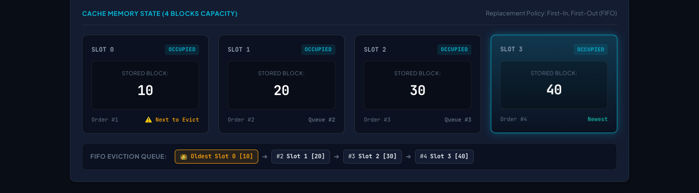
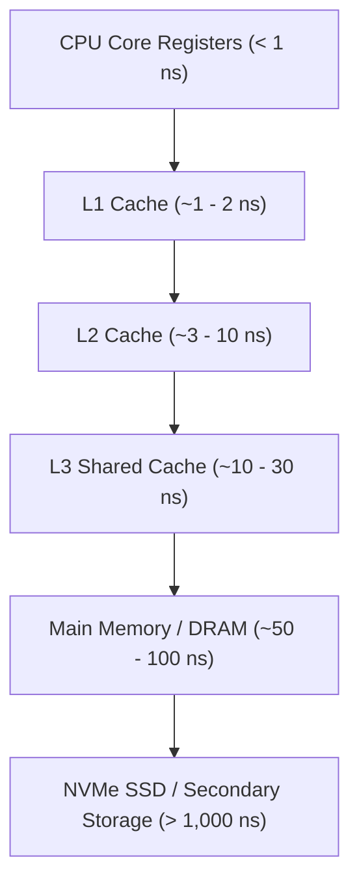

# CacheFlow

[](https://github.com/Kartik-idk/CacheFlow/actions)
[](https://cacheflow-ten.vercel.app)
[](https://developer.mozilla.org/en-US/docs/Web/JavaScript)
[]()

> An interactive, browser-based CPU cache memory simulator and architecture learning tool demonstrating cache block allocation, FIFO eviction mechanics, and Average Memory Access Time (AMAT) calculation.

[**Explore Live Interactive Simulator**](https://cacheflow-ten.vercel.app)

---

## Simulator Interface



*Figure: Real-time simulation of CPU memory reference stream showing active 4-slot cache lines, hit/miss detection, FIFO eviction queues, and live AMAT latency computation.*

---

## Conceptual Overview

Modern processor speed far outpaces main memory (DRAM) access velocity—a disparity known as the *memory wall*. Multi-level CPU cache hierarchies bridge this gap by exploiting **temporal locality** (recently accessed data is accessed again soon) and **spatial locality** (nearby memory addresses are accessed sequentially).

**CacheFlow** translates these textbook concepts into an interactive visual model:
- Step through individual memory address references.
- Watch cache blocks populate, hit, and evict in real time.
- Directly observe how hit ratios dynamically shift Average Memory Access Time (AMAT).

---

## Memory Hierarchy & Latency Scale



### FIFO Replacement & AMAT Formulation

When all four cache lines are saturated and a cache miss occurs, the simulator triggers **First-In, First-Out (FIFO)** replacement: the block that has occupied the cache the longest is evicted to accommodate the incoming address.

The engine dynamically recalculates **Average Memory Access Time (AMAT)**:

$$\text{AMAT} = \text{Hit Time} + (\text{Miss Rate} \times \text{Miss Penalty})$$

Where:
- $\text{Hit Time}$: Time required to service an access from the cache (normalized to 1 cycle).
- $\text{Miss Rate}$: Ratio of cache misses to total memory references ($\frac{\text{Misses}}{\text{Total References}}$).
- $\text{Miss Penalty}$: Memory retrieval latency from lower hierarchy levels.

---

## Features

- **4-Slot Live Cache Line Visualizer:** Color-coded status tags for *Hit* (emerald green), *Miss* (amber), and *Eviction* (rose red).
- **Step-by-Step Reference Dispatch:** Enter arbitrary memory addresses or run curated benchmark sequences (sequential scan, tight loops, cache thrashing).
- **Live Performance Telemetry:** Real-time metrics tracking Total References, Hit Count, Miss Count, Hit Ratio (%), Miss Ratio (%), and AMAT.
- **Zero Framework Footprint:** Engineered exclusively with clean vanilla JavaScript, HTML5 semantic elements, and modern CSS variables.

---

## Technology Stack

| Layer | Implementation |
| :--- | :--- |
| **Markup** | Semantic HTML5 with ARIA live regions |
| **Styling** | Modern CSS3 (CSS Grid, Flexbox, Custom Properties) |
| **Scripting & Logic** | Vanilla JavaScript (ES6+ Classes, Event-driven architecture) |
| **CI & Validation** | `node --check` syntax validation, GitHub Actions |
| **Hosting** | Vercel Static Hosting |

---

## Local Setup & Quick Start

Because CacheFlow has zero runtime dependencies, no build step or node package installation is required:

1. **Clone repository:**
   ```bash
   git clone https://github.com/Kartik-idk/CacheFlow.git
   cd CacheFlow
   ```

2. **Run locally:**
   Simply open `index.html` in any modern web browser:
   ```bash
   open index.html   # On macOS
   ```
   Or serve using any local HTTP static server:
   ```bash
   npx serve .
   ```

3. **Verify syntax:**
   ```bash
   node --check script.js
   ```

---

## File Organization

```text
CacheFlow/
├── assets/
│   └── cacheflow_simulator_preview.png  # High-resolution UI preview
├── index.html                           # Accessible semantic DOM structure
├── script.js                            # Simulator engine, state machine, and FIFO queue
├── style.css                            # Responsive CSS layout and animations
└── .github/workflows/
    └── quality.yml                      # Automated static syntax validation
```
